# Pressure Players

<div align="center">

**Cricket analytics for the moments that swing a match**

[](https://react.dev/)
[](https://www.typescriptlang.org/)
[](https://vite.dev/)
[](https://recharts.github.io/)
[](#)

**777 matches · 184,156 deliveries · 36,853 high-pressure deliveries**

</div>

Pressure Players is an interactive cricket performance dashboard for IPL and T20I cricket. It measures how batters and bowlers perform when a delivery can materially change the result, then places that performance alongside everyday skill and sample-level uncertainty.

The application is a client-side React dashboard backed by a curated JSON dataset. It does not require a database or backend for the supplied experience.

---

## Contents

- [What the dashboard answers](#what-the-dashboard-answers)
- [Product overview](#product-overview)
- [Feature map](#feature-map)
- [Application routes](#application-routes)
- [Architecture](#architecture)
- [Data and scoring pipeline](#data-and-scoring-pipeline)
- [Visual analytics](#visual-analytics)
- [Technology stack](#technology-stack)
- [Project structure](#project-structure)
- [Getting started](#getting-started)
- [Available scripts](#available-scripts)
- [Working with the data](#working-with-the-data)
- [Theme and navigation](#theme-and-navigation)
- [Reliability and interpretation](#reliability-and-interpretation)
- [Limitations](#limitations)
- [Troubleshooting](#troubleshooting)
- [Contributing](#contributing)

---

## What the dashboard answers

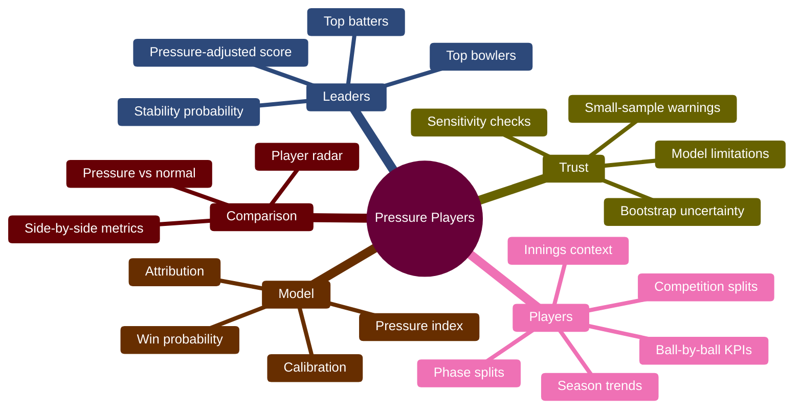

The project separates three kinds of questions:

| Question | Dashboard area |
|---|---|
| Who leads under pressure? | Overview, batter and bowler hubs, leaderboard |
| How does one player perform? | Player profile |
| How do selected players compare? | Side-by-side comparison |
| What is pressure, exactly? | Pressure model |
| How trustworthy is a ranking? | Reliability and limitations |
| How is every metric calculated? | Methodology and printed report |

---

## Product overview


The supplied dataset represents 777 matches, 184,156 deliveries, 36,853 high-pressure balls, 77 eligible batters, and 92 eligible bowlers.

---

## Feature map

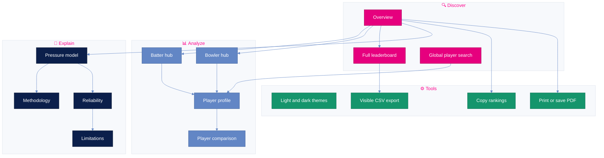

### Core capabilities

- Responsive desktop and mobile navigation
- Light and dark color themes with persisted preference
- `Ctrl/Cmd + K` global search palette
- Player search and ranking filters
- 20-row leaderboard pagination
- Visible leaderboard CSV download
- Batter and bowler scorecards
- Player-to-player radar, bar, and table comparisons
- Printable and PDF-ready report
- Low-sample and uncertainty indicators
- Route-level fallback to the overview

---

## Application routes

| Route | Purpose |
|---|---|
| `/` | Executive overview, key KPIs, and top leaders |
| `/batters` | Batter leaderboard and split analysis |
| `/bowlers` | Bowler leaderboard and split analysis |
| `/batters/:pid` | Individual batter profile |
| `/bowlers/:pid` | Individual bowler profile |
| `/leaderboard` | Searchable and sortable eligible-player leaderboard |
| `/compare` | Select up to four players in the same role |
| `/pressure` | Pressure model, calibration, and pressure classes |
| `/reliability` | Predictive validity and bootstrap sensitivity |
| `/methodology` | Data scope, formulas, shrinkage, and glossary |
| `/limitations` | Known weaknesses and uncertain featured players |
| `/report` | Printable report summary and chart edition |

Unknown routes fall back to the overview.

---

## Architecture

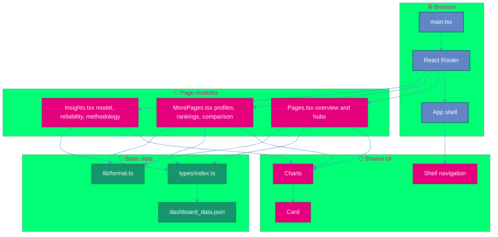

### Runtime data flow

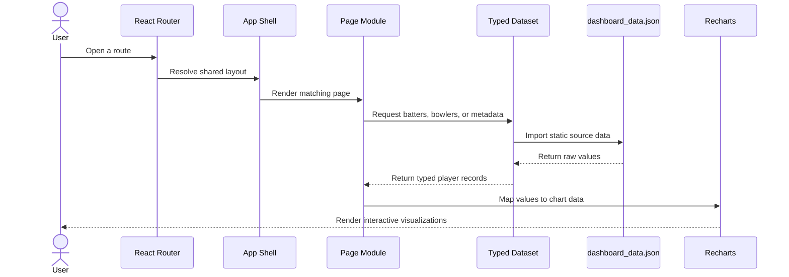

---

## Data and scoring pipeline

### Dataset scope

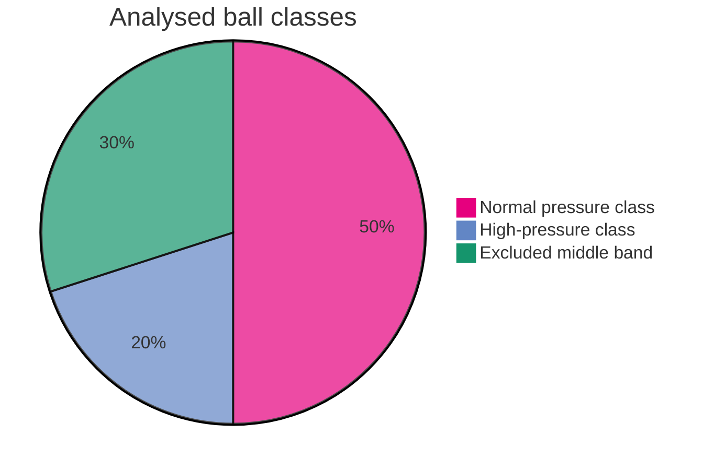

The pie chart reflects a conceptual split of the 184,156 deliveries: 36,853 high-pressure balls, while 55,225 remain in the excluded middle band and 92,078 in the normal-pressure class.

### Scoring sequence

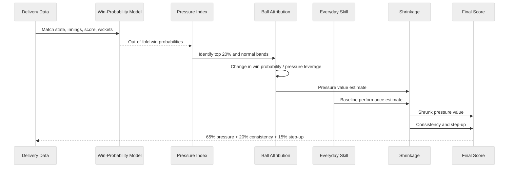

### Final score formula

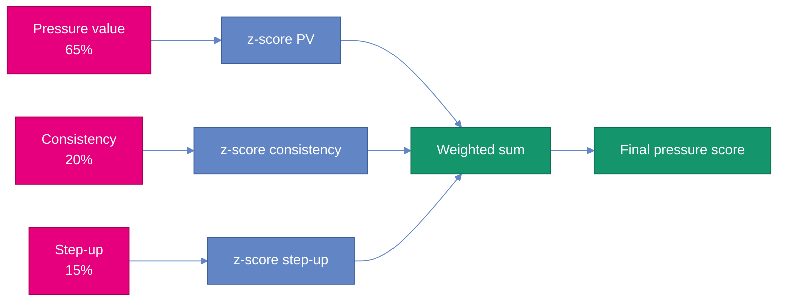

The supplied model weights are:

| Component | Weight |
|---|---:|
| Pressure value | 65% |
| Consistency | 20% |
| Step-up | 15% |

Additional rules:

- High pressure: top 20% pressure index
- Normal: bottom 50% pressure index
- Eligible batters: at least 90 pressure balls and 12 pressure innings
- Eligible bowlers: at least 90 pressure balls and 12 pressure innings
- Split values under 30 balls are marked as low sample
- Fixed seeds are used for bootstrap and model sampling

---

## Visual analytics

The dashboard uses Recharts for interactive, responsive visualizations.

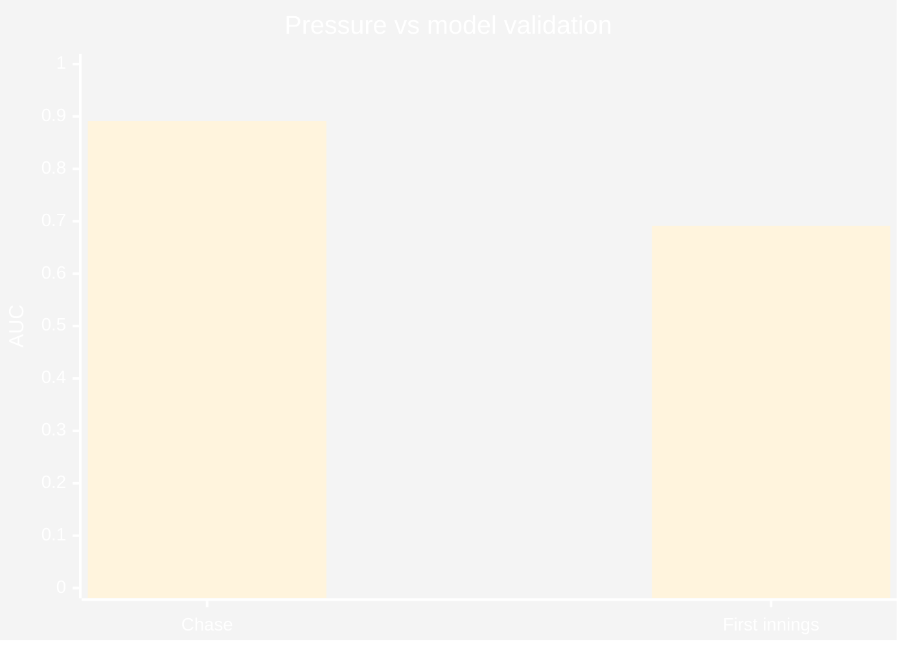

### Charts in the application

| Chart | Use |
|---|---|
| Horizontal bar | Pressure values and predictive validity |
| Vertical bar | Pressure vs normal performance, seasons, and innings |
| Stacked bar | IPL vs T20I pressure ball counts |
| Scatter | Pressure value vs consistency |
| Radar | Player percentile profiles and side-by-side comparison |
| Line | Pressure index by over and match trends |
| Composed chart | Rank ranges and match-level timelines |
| Pie/donut | Competition share |
| Heat map-style table | Phase and split results |
| Bootstrap range | Final rank and 10th–90th percentile uncertainty |

The project palette includes:

- Magenta `#E6007E`
- Navy `#0B1F4B`
- Blue `#6286C5`
- Green `#15956C`
- Amber `#C78117`
- Neutral slate and surface colors

---

## Technology stack

| Area | Choice |
|---|---|
| UI library | React 19 |
| Language | TypeScript 5.7 |
| Build and dev server | Vite |
| Routing | React Router DOM |
| Charts | Recharts |
| Icons | Lucide React |
| Styling | Tailwind CSS 4 import plus custom CSS |
| Motion | Framer Motion |
| Data | Static JSON |
| Package workflow | pnpm workspace lockfile |

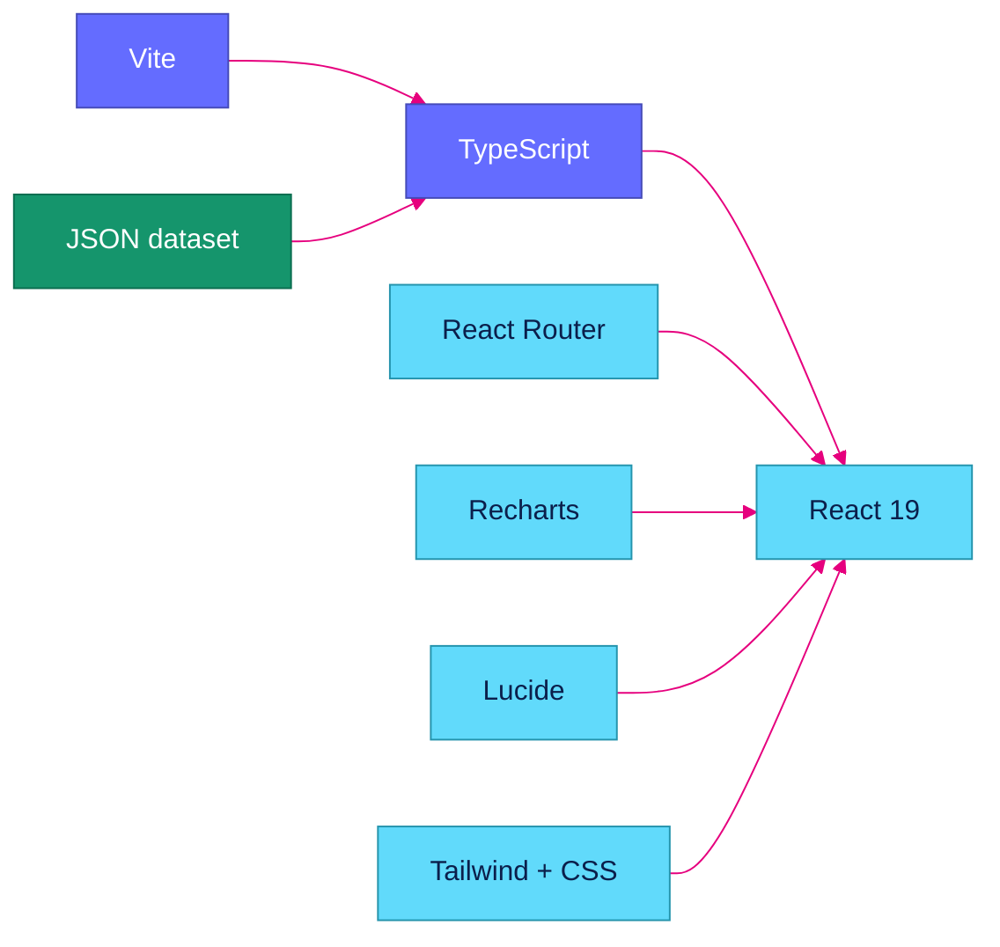

---

## Project structure

```text
pressure-players-dashboard/
├── public/
│   ├── apple-icon.png
│   ├── icon*.png
│   ├── icon.svg
│   └── placeholder assets
├── src/
│   ├── components/
│   │   ├── Card.tsx
│   │   ├── Charts.tsx
│   │   └── Shell.tsx
│   ├── data/
│   │   └── dashboard_data.json
│   ├── lib/
│   │   └── format.ts
│   ├── pages/
│   │   ├── Insights.tsx
│   │   ├── MorePages.tsx
│   │   └── Pages.tsx
│   ├── types/
│   │   └── index.ts
│   ├── main.tsx
│   └── styles.css
├── index.html
├── package.json
├── pnpm-lock.yaml
├── pnpm-workspace.yaml
├── tsconfig.json
└── vite.config.ts
```

### Module responsibilities

| Module | Responsibility |
|---|---|
| `main.tsx` | React bootstrap, route declarations, and app routing |
| `Shell.tsx` | Sidebar, topbar, search palette, theme, and mobile navigation |
| `Pages.tsx` | Overview and batter/bowler hubs |
| `MorePages.tsx` | Profiles, full leaderboard, and comparisons |
| `Insights.tsx` | Pressure model, reliability, methodology, limitations, and report |
| `Charts.tsx` | Reusable chart wrappers and chart primitives |
| `types/index.ts` | Dataset imports and TypeScript player types |
| `format.ts` | Number, percentage, count, and initials formatting |
| `dashboard_data.json` | Static player, league, model, and ranking data |

---

## Getting started

### Prerequisites

- Node.js 18 or newer
- pnpm recommended
- A modern desktop or mobile browser

### Installation

```bash
pnpm install
```

Using npm is also possible:

```bash
npm install
```

### Development

```bash
pnpm dev
```

Vite exposes the app on `0.0.0.0`. Open the local URL shown in the terminal, usually:

```text
http://localhost:5173
```

### Production build

```bash
pnpm build
```

The build runs TypeScript project compilation followed by Vite bundling. Preview the production build with:

```bash
pnpm preview
```

---

## Available scripts

| Command | Action |
|---|---|
| `pnpm dev` | Start the Vite development server |
| `pnpm build` | Run TypeScript build checks and create the production bundle |
| `pnpm preview` | Serve the production bundle locally |

The package also exposes the equivalent npm scripts:

```bash
npm run dev
npm run build
npm run preview
```

---

## Working with the data

The application imports [dashboard_data.json](src/data/dashboard_data.json) through [types/index.ts](src/types/index.ts). The JSON supplies:

- Dataset metadata
- League-level model values
- Pressure index distributions
- Batter records
- Bowler records
- Full eligible-player leaderboards
- Bootstrap rank ranges
- Player splits and match timelines

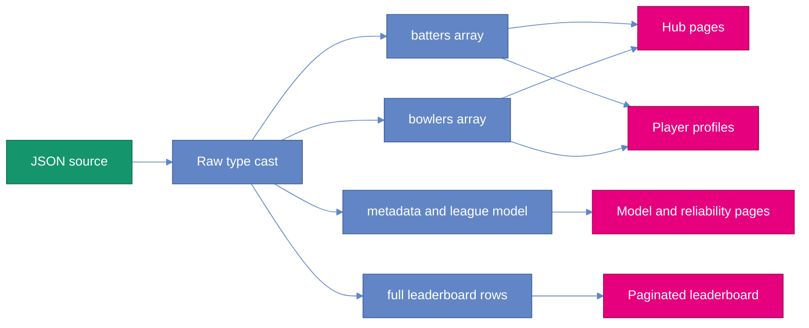

For new data:

1. Preserve existing field names or update the exported types.
2. Replace or regenerate `src/data/dashboard_data.json`.
3. Validate every player, split, and league object used by a page.
4. Build the application to catch structural TypeScript issues.
5. Verify split values below 30 balls remain visibly marked low sample.

---

## Theme and navigation

### Theme preference

The app stores the selected theme in browser `localStorage` under `pp-theme`. It applies the `dark` class to the document root.

### Global search

Press `Ctrl + K` on Windows/Linux or `Cmd + K` on macOS to open the command palette.

The palette searches:

- Batter names
- Bowler names
- Product pages
- The available route labels

Use `Escape` to close the palette.

### Mobile navigation

At narrow widths, the dashboard exposes:

- A menu button
- A slide-out sidebar
- Bottom quick-navigation tabs
- Responsive chart containers and horizontally scrollable tables

---

## Reliability and interpretation

The pressure signal is weak and should be interpreted as a comparative estimate, not an absolute rating.

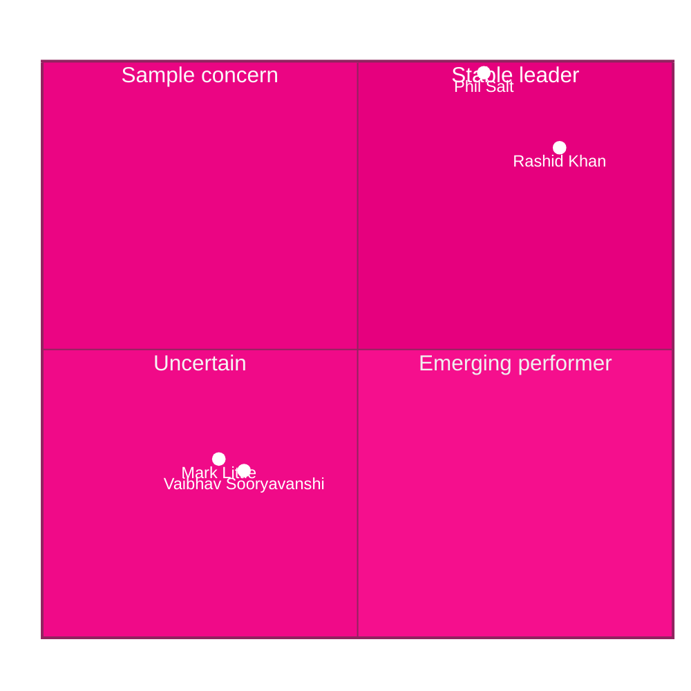

Key findings represented in the supplied dataset:

- Chase model AUC: `0.891`
- First-innings model AUC: `0.691`
- Blending pressure performance with everyday skill improves predictive validity
- Bootstrap ranges show rank uncertainty
- Results can move under strict pressure thresholds
- Batter rankings are generally more stable than bowler rankings
- Rashid Khan is described as the firmest featured bowler pick

Use pressure value as the primary shrunk estimate. Raw split values are diagnostic context, particularly on low-volume phases.

---

## Limitations

- Pressure-specific differences are noisy and sample-dependent.
- First-innings prediction is weaker than chase prediction.
- Partnerships, field settings, matchup quality, and individual opponent quality are not fully credited.
- The Elo team-strength feature is approximate.
- IPL and T20I samples are uneven across players.
- Players with limited pressure observations can move substantially in bootstrap resamples.
- Raw season and phase splits can become unstable with fewer than 30 balls.
- The dashboard evaluates the supplied dataset and does not create a live feed.

When interpreting a profile:

1. Check pressure balls and pressure innings.
2. Review `rank_p10` and `rank_p90`.
3. Review top-10 bootstrap probability.
4. Inspect split sample counts.
5. Compare pressure performance against everyday skill.
6. Treat low-sample labels as uncertainty warnings.

---

## Troubleshooting

| Issue | Check |
|---|---|
| App cannot start | Confirm Node.js and dependencies are installed |
| Route returns to overview | Verify the player ID exists in the matching dataset array |
| Chart displays no data | Confirm the relevant JSON array and numeric fields exist |
| CSV does not download | Check browser download permissions and popup restrictions |
| Dark mode does not persist | Check whether local storage is blocked or cleared |
| Production route refresh fails | Configure the host to serve `index.html` for unknown routes |
| Split appears as `n/a` | The JSON value may be `null`, missing, or not a number |

For static hosting, React Router’s BrowserRouter requires fallback rewrites to `index.html` for client-side routes.

---

## Contributing

1. Keep player identifiers stable.
2. Follow the existing page and card patterns.
3. Reuse format helpers for counts, percentages, and decimals.
4. Mark split values with fewer than 30 balls as low sample.
5. Update route declarations and sidebar links together.
6. Update this README when routes, metrics, scripts, or data structures change.
7. Run `pnpm build` before submitting changes.

---

<div align="center">

**Pressure Players · SupeRR Selector Season 2 · Round 1**

</div>
